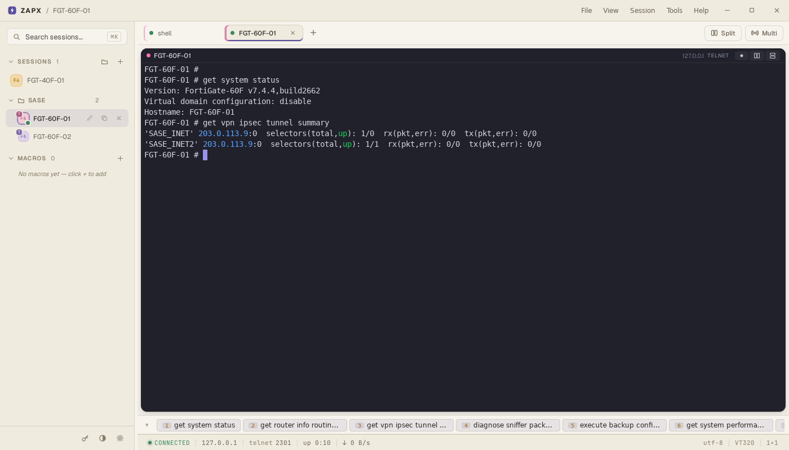
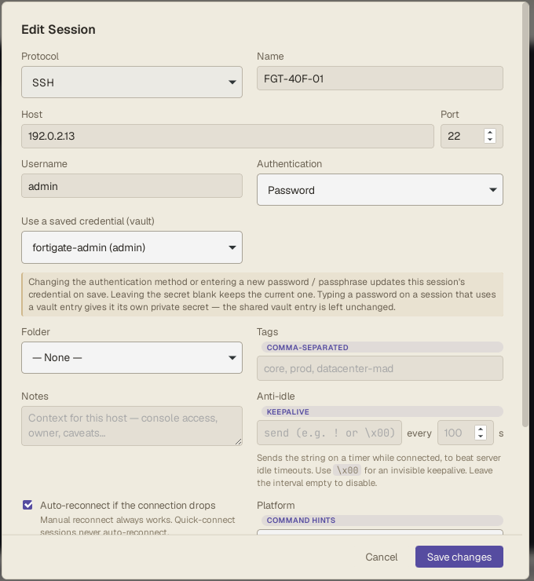
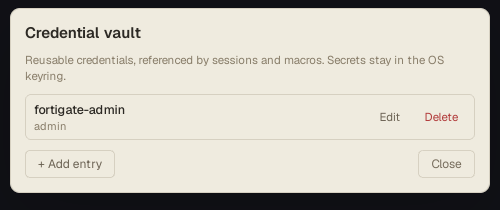

# ZapTerm — User Guide

A modern multi-protocol terminal for network engineers — SSH, Telnet, Serial
and local shell in one app, with a session manager, credential vault, macros,
SFTP, port forwarding, split panes and multi-host broadcast.

> Screenshots below are marked with `<!-- CAPTURE: … -->` notes describing what
> each image should show. Drop PNGs into `docs/user-guide/images/` using the
> referenced file names to fill them in.

## Contents

1. [The workspace](#1-the-workspace)
2. [Sessions](#2-sessions)
3. [Connecting & authentication](#3-connecting--authentication)
4. [Credential Vault](#4-credential-vault)
5. [Macros](#5-macros)
6. [Command lists & the bottom bar](#6-command-lists--the-bottom-bar)
7. [Command hints & platform detection](#7-command-hints--platform-detection)
8. [Keyword highlighting](#8-keyword-highlighting)
9. [SFTP & port forwarding](#9-sftp--port-forwarding)
10. [Splits & multi-exec](#10-splits--multi-exec)
11. [Session logging](#11-session-logging)
12. [Settings & appearance](#12-settings--appearance)
13. [Import & export](#13-import--export)
14. [Security model](#14-security-model)
15. [Keyboard shortcuts](#15-keyboard-shortcuts)

New to ZapTerm and want to automate devices? Start with the step-by-step
[automation guide](automation/README.md) (saved sessions, vault, Python scripts,
notebooks).

---

## 1. The workspace



- **Left sidebar** — your saved **Sessions** (in folders) and your **Macros**
  library. **Drag the divider** between the sidebar and the terminal to widen it
  (up to half the window) so long session names fit; double-click the divider to
  reset. The width is remembered across restarts.
- **Tab strip** — one tab per open session (or per split). Rename, recolour,
  duplicate or close from the tab; `Split` and `Multi` buttons on the right.
- **Terminal card** — the active terminal, a rounded card. Its header exposes
  per-session actions (record log, SFTP, port forwards, split).
- **Bottom bar** — the **command lists** for the focused session's platform,
  plus **★ Custom** (your own commands) and **Recent**.
- **Status bar** — connection state, host, protocol, encoding and terminal size.

---

## 2. Sessions



- **New saved session** (`Ctrl+N`): pick a protocol (SSH / Telnet / Serial /
  local), fill host, port, username and authentication. Optionally set a colour,
  notes and comma-separated tags.
- **Quick Connect** (`Ctrl+Shift+N`): connect ad-hoc without saving anything.
- **Organise**: create folders, **drag-and-drop** sessions between them and
  reorder; **search** (`⌘K` / `Ctrl+K` focuses the box) matches name, tags and
  notes.
- **Row actions** (hover): edit, duplicate (a fully independent copy), delete.
- Sessions are ordered by last use, so the ones you open most surface at the top
  of their folder.

---

## 3. Connecting & authentication

- **SSH auth**: password, public key, SSH agent, or keyboard-interactive (2FA).
- **Use a saved credential (vault)**: in the session dialog, pick a vault entry
  instead of typing a password. The session then logs in with the **entry's
  user and password**: both fields are shown locked, and changing either in the
  vault changes it for every session that uses the entry. An entry without a
  user leaves **Username** to the session (one password shared by several
  users). To give the session its own password again, choose *— type a
  password —*. See [Credential Vault](#4-credential-vault).
- **Host-key verification**: on first connect ZapTerm shows the server's SHA-256
  fingerprint for you to approve; it's pinned in `known_hosts` and a later change
  is flagged.
- **Jump hosts / ProxyJump**: route a session through another saved session.
- **Auto-reconnect**: on by default; a dropped link shows a one-click reconnect
  banner. Disable per session with the "Auto-reconnect if the connection drops"
  checkbox. Quick-connect and local sessions never auto-reconnect.
- **Anti-idle / keepalive**: send a string on a timer while connected (e.g. an
  invisible `\x00`) to beat server idle timeouts.

---

## 4. Credential Vault

Reusable named credentials, stored securely and referenced by name — so a
password lives in exactly one place and never appears in a macro, an export, or
a log.



- **An entry has a Name (label), a Username, and a Password.** The **Name** is
  what you reference elsewhere — it is *not* the username.
- **Create/edit** entries from the Vault dialog. Names are unique. While you
  are editing an entry, the form only goes away with Cancel, Save or Close.
- **Use it two ways**:
  - Attach it to a saved session (the session's auth "Use a saved credential").
  - Reference it from a macro: `{{vault:<Name>.Password}}` or
    `{{vault:<Name>.Username}}` (see [Macros](#5-macros)).
- **Where the secret lives**: in ZapTerm's encrypted vault (see
  [Security model](#14-security-model)). The secret is resolved in the backend
  at run time and written straight to the session — it never reaches the UI,
  JSON, exports or logs.

---

## 5. Macros

A macro is a saved **expect / send / wait** sequence you run against the focused
session with one click — for logins, jump-host hops, and repetitive command
flows. Macros live in the **MACROS** zone of the sidebar.

> Need conditions, loops or several devices? Write a Python script instead —
> see [Python scripting](scripting.md).

<!-- CAPTURE: images/macros-zone.png — the sidebar MACROS section with a couple
of folders and macros, and the header icons (import ↓ / export ↑ / MobaXterm /
new +). -->


### Running & organising

- **Click a macro** to run it on the focused session.
- Rows behave like sessions: hover for **clone / export / edit**; **drag** to
  reorder within a folder or drop onto a folder to move it. Organise into
  folders.
- Header icons: **new** (+) is always shown; hover the MACROS header for
  **export all** (arrow up), **import JSON** (arrow down) and **import from
  MobaXterm**.

### Editing steps

<!-- CAPTURE: images/macro-editor.png — the Edit macro dialog showing the Steps
list: an `expect` step with the regex (.*) checkbox, a `send` step with the 🔒
vault picker, and a `wait` step. -->


Each step is one of:

- **expect** — wait for a string to appear. Tick **`.*`** to match it as a
  **regular expression** (e.g. `password:\s*$`); leave it unticked for a plain
  substring. An expect step *only waits* — it doesn't send anything.
- **send** — send text. Use `\r` for Enter (e.g. `show version\r`). To send a
  vault secret, use the **🔒 vault** picker on the step: it inserts
  `{{vault:<Name>.Password}}` (or `.Username`). A ⚠️ badge warns if a vault
  reference is malformed (e.g. a typo in the field).
- **wait** — pause a number of milliseconds.

A typical login macro:

```
send    ssh user@10.0.0.1\r
expect  password:\s*$            (.* ticked)
send    {{vault:core-router.Password}}\r
```

> **Why expect and send are separate:** expect just waits; the typing goes in the
> next `send` step, which is where the vault picker lives — so you can reference
> a vault password for any prompt. Older macros that combined the two are split
> automatically when opened.

### Vault references

- `{{vault:<Name>.Password}}` / `{{vault:<Name>.Username}}` — `<Name>` is the
  vault entry's **Name** (label), and the field must be exactly `Password` or
  `Username`. The secret is resolved server-side; only the placeholder is ever
  stored in the macro or its export.
- Pick from the **🔒 menu** rather than typing, to avoid typos.

### Edit as JSON

Toggle **Steps / JSON** in the macro dialog to hand-edit the step list as JSON
(with live validation). Remember JSON escaping: a regex `password:\s*$` is
written `"password:\\s*$"`.

### Run on connect

Attach a macro to a saved session so it runs automatically each time the session
connects (set in the New/Edit Session dialog).

### Import / export

- **Export** one macro or all of them to a human-readable JSON file (steps are a
  real array; vault references export as the placeholder only, never the
  secret).
- **Import** those JSON files back (older single-string exports still import).
- **Import from MobaXterm**: paste a MobaXterm macro/`[Macros]` export; ZapTerm
  converts `WAITFOR=`→expect, `SLEEP=`→wait, `RETURN`→Enter, and can stash a
  password into the vault instead of importing it in plaintext.

---

## 6. Command lists & the bottom bar

- **Command lists** are menus of ready-made commands for the platform ZapTerm
  detected on the focused tab (FortiGate, Cisco IOS / IOS XE, IOS XR, Arista
  EOS, Junos, FortiManager, FortiAnalyzer, Linux, macOS, Windows). Click a
  command to run it; Shift+click, or the Type button, types it without Enter.
  Commands with a `<value>` and multi-line recipes ask for their values first.
- Commands that can load a device (real-time debugs, captures) show a ⚠ badge
  and ask before they are sent.
- **By OS release.** The FortiGate lists cover FortiOS 7.2, 7.4 and 7.6. Run
  `get system status` once: ZapTerm reads the version, remembers it for the
  session and shows the commands of that release (for example
  `diagnose sys sdwan service` up to 7.4.3 and `service4` / `service6` from
  7.4.4). Before it knows the version it shows the newest forms. The same
  status line also turns a session first taken for Linux into FortiGate.
- **★ Custom** holds your own commands, on every platform; **Recent** lists
  the commands you used last.
- **Edit the lists**: Settings → Command Lists → *Make my copy* writes that
  platform's lists as a JSON file you can change; updates never touch it.
- Plain **snippets were retired in 1.5.0**: the ones you had were moved to
  ★ Custom. **Macros** (multi-step, in the sidebar MACROS zone) are unchanged.
- **Security**: a value you type at a **password prompt is never recorded** to
  history, Recent or hints (and can't resurface as a "previous command").
  Neither is a configuration command that carries a secret as an argument
  (`set psksecret …`, `enable secret …`, `username … password …`,
  `snmp-server community …`); commands that only read, such as
  `show run | include password`, are remembered.

---

## 7. Command hints & platform detection

- As you type, ZapTerm suggests commands from your history and per-vendor catalogs
  (9 platforms). Accept a ghost suggestion with `→` / `End`; open the
  suggestion popup with `Ctrl+Space`.
- The session's **platform is auto-detected** from the banner and prompt, so
  suggestions and command lists match the device.

---

## 8. Keyword highlighting

Per-rule regex highlighting with true-colour ANSI, over user-overridable vendor
catalogs (Cisco, Arista, Juniper, Fortinet…). Configure rules in Settings.

---

## 9. SFTP & port forwarding

<!-- CAPTURE: images/sftp.png — the SFTP file browser dialog with a transfer in
progress. -->


- **SFTP** (SSH sessions): browse, upload and download with progress and cancel;
  edit a remote file with your local editor.
- **Port forwarding**: local `-L`, dynamic `-D` (SOCKS5) and remote `-R`
  forwards, managed per session from the pane header. Forwards saved on a
  session (**Port forwards** at the bottom of the session dialog) start
  automatically on connect. Give each one a **name** ("FortiGate GUI", "RDP to
  jump host"…): it is shown above the mapping in the session dialog, the pane's
  port-forwards list and **Tools → Active tunnels…**.

---

## 10. Splits & multi-exec

- **Split panes** (`Ctrl+\` / `Ctrl+Shift+\`): recursive horizontal/vertical
  splits; open a saved session into an empty split by clicking it in the
  sidebar or dragging it onto the empty pane.
- **Multi** (`Ctrl+Shift+M`): type once in several sessions. It is set per
  tab and needs two or more sessions in it — split the tab or open a group;
  with one session the button is greyed out and says so. While it is on, the
  button reads "Multi · 3", the tab shows a broadcast icon, every pane has a
  coloured border, and what you type in any pane (or a list command you click)
  goes to all the sessions of that tab — never to other tabs. It turns itself
  off when the tab is left with one session. The **SEND TO ALL** bar under the
  panes sends a whole line to all of them; in a grid opened from a group it is
  always there.
- **Run & compare** (SEND TO ALL bar, in a split or a grid): sends the command
  to every pane and compares what each one printed between the command and the
  prompt that came back (spaces at line ends ignored). The result opens in a
  panel under the terminals and as a mark in each pane's header: **=** every
  pane printed the same; **A**, **B**… which version this pane printed (A is
  the most common, or on a tie the left-most pane's); **…** still waiting;
  **–** no reply; **!** the capture may be incomplete. With two versions the
  differences show straight away; with more, each one can be compared with A.
  The panel warns when panes are connected to the same device (same output
  expected), when the output still stopped at a `--More--` prompt, and when no
  prompt came back within 10 s. **Page through --More--** (on by default)
  presses Space for you when a device stops at a pager prompt (`--More--`,
  `---(more)---`, `<--- More --->`) after a line sent from the SEND TO ALL bar,
  with Enter or with Run & compare: only in that session, up to 200 pages, so
  you get the whole output; Run & compare leaves the pager prompts out of the
  comparison. What you type straight into a pane is not paged. Panes with the same
  name are told apart as "name (pane 2)". **Send keys as I type** in the SEND
  TO ALL bar sends every key to all the sessions as you type it (for what a
  device answers before Enter, such as `?` for context help on Cisco IOS),
  Backspace included; Run & compare then only presses Enter. Off (the default),
  nothing is sent until Enter.

---

## 11. Session logging

Record a session to a rotating file (plain text or raw), started from the pane
header's record button. A per-session history panel lists past logs.

---

## 12. Settings & appearance

<!-- CAPTURE: images/settings-terminal.png — Settings → Terminal panel: Theme
selector, Font family + size, cursor style. -->


- **Themes**: full UI + terminal ANSI palettes (Settings → Terminal).
- **Font**: family and size for the terminal; cursor style and blink.
- **Shortcuts**: every keybinding is customizable (Settings → Shortcuts).
- **Data folder**: where ZapTerm stores its database, logs and catalogs (Settings →
  Data), or force it with `ZAPTERM_DATA_DIR` / `--data-dir`.
- **Updates** (Help → Check for updates…): ZapTerm never checks on its own.
  When you open this dialog it asks GitHub for the newest release, shows it
  with its notes and, if you want, downloads the installer that matches your
  copy (setup EXE, MSI, portable EXE, DMG, DEB, RPM or AppImage) into your
  Downloads folder, checked against the SHA-256 GitHub publishes. The setup
  EXE and the MSI install with one click (ZapTerm closes for it); the others
  open the installer or show the file. A copy from the Microsoft Store is
  updated by the Store. Stable versions are offered to stable copies; a beta
  copy is also offered newer betas.

---

## 13. Import & export

- **Sessions bundle**: one JSON with sessions (and their port forwards and
  triggers), folders, groups, macros and highlight rules (**never passwords**)
  — idempotent import for backup, migration and team sharing. The ★ Custom
  list and your copies of the command lists are not in it; the **encrypted
  backup** (Settings → Backup) and sync include them, together with the
  passwords and vault entries.
- **Importers**: `~/.ssh/config`, PuTTY, MobaXterm and SecureCRT.
- **Add devices in bulk** (File menu): paste a list of hosts or open a CSV
  file and add them all as saved sessions, after a preview — see
  [Add devices in bulk](automation/4-bulk-add.md).
- **Macros**: exported/imported separately as their own JSON (see
  [Macros](#5-macros)).
- The **vault and its secrets are never included** in any export.

---

## 14. Security model

- **Encrypted vault.** Every saved password (sessions, vault entries, the sync
  passphrase) is encrypted with AES-256-GCM under a random vault key, inside
  ZapTerm's database. Secrets never enter SQLite in cleartext, exports, or
  logs.
- **Master password.** The vault key is protected by a master password you
  choose the first time ZapTerm starts (at least 14 characters; a few unrelated
  words work well). A copy of ZapTerm's data is useless without it. **It cannot
  be recovered**: keep an encrypted backup (Settings → Backup) as a way back.
- **Opening ZapTerm.** On an installed copy, "Remember on this computer"
  (Settings → Vault) keeps the vault key in the OS keyring, protected by your
  user account, so ZapTerm opens without asking. Turn it off to be asked for
  the master password at every start; "Lock now" closes the vault at once.
- **Portable copies** always ask for the master password at start and never
  store anything in the keyring of the computer they run on.
- **Coming from an older version.** The first time the vault opens, passwords
  that were in the OS keyring or in the database under `vault.key` are moved
  into it and removed from where they were; `vault.key` is deleted once
  nothing depends on it. After that, an older ZapTerm can no longer open this
  data — make a backup before updating if you may need to go back.
- **Backups** are sealed with their own passphrase (at least 14 characters for
  a new one), separate from the master password.
- **Vault secrets** are resolved in the backend at run time and written straight
  to the session — the macro/export only ever holds the `{{vault:…}}`
  placeholder.
- **Passwords typed at a prompt** are not recorded to command history / recents.
- **Host-key verification** with SHA-256 fingerprints and `known_hosts`.
- Session logs capture terminal bytes only; the PTY doesn't echo passwords.

---

## 15. Keyboard shortcuts

All customizable in **Settings → Shortcuts**. Defaults:

| Shortcut | Action |
|---|---|
| `Ctrl+K` | Command palette |
| `Ctrl+N` | New saved session |
| `Ctrl+Shift+N` | Quick Connect |
| `Ctrl+T` | New local shell tab |
| `Ctrl+W` | Close current tab |
| `Ctrl+Tab` / `Ctrl+Shift+Tab` | Next / previous tab |
| `Ctrl+\` / `Ctrl+Shift+\` | Split horizontally / vertically |
| `Ctrl+Shift+M` | Toggle multi-exec broadcast |
| `Ctrl+Space` | Command suggestion popup |
| `Ctrl+F` | In-terminal search |
| `Ctrl+,` | Settings |
| `Escape` | Close search / dialog |
