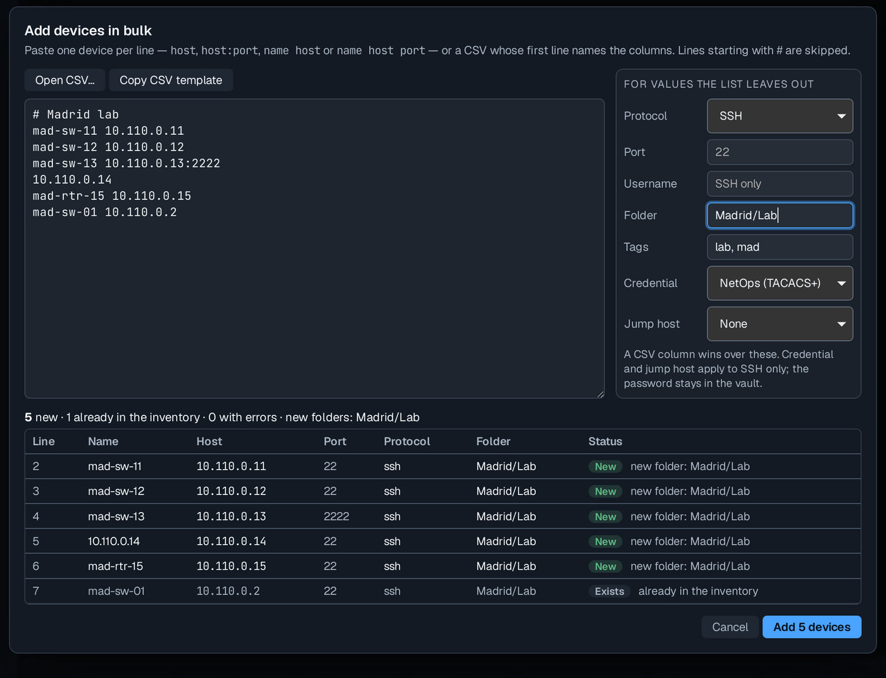

# 4. Add devices in bulk

[← 3. Notebooks](3-notebooks.md) · [Guide index](README.md)

Scripts and group actions work on **saved sessions**: that is where the jump
host, the vault credential and the login script of a device live. **File → Add
devices in bulk…** turns a list of devices into saved sessions in one go.



## 1. Give it a list

Paste it, or open a file with **Open CSV…** (`.csv`, `.txt`, `.tsv`; UTF-8,
UTF-16 or Windows-1252, as spreadsheets save them).

**A plain list**, one device per line:

```text
# Madrid lab
mad-sw-11 10.110.0.11
10.110.0.14
mad-sw-13 10.110.0.13:2222
mad-rtr-15 10.110.0.15 830
```

That is: name and host; a host alone (it is also the name); `host:port`; and
name, host and port. Spaces, tabs or commas separate the values.

**A CSV**, whose first line names the columns, in any order, separated by
commas, semicolons or tabs (so you can paste straight from a spreadsheet):

```csv
name,host,port,protocol,username,folder,tags,notes,credential,jump_host
core-sw-01,10.10.0.2,22,ssh,netops,DC/Madrid,"core,mad",Rack 4,Lab admin,bastion
```

| Column | Also accepted as | Meaning |
|---|---|---|
| `host` (required) | `ip`, `address`, `mgmt ip`, `fqdn` | Host name or address; `host:port` works too. |
| `name` | `device`, `hostname`, `session`, `label` | Name of the session; the host when empty. |
| `port` | | 1–65535; 22 for SSH and 23 for Telnet when empty. |
| `protocol` | `proto` | `ssh` or `telnet`. |
| `username` | `user`, `login` | SSH user name. |
| `folder` | `path`, `group`, `site` | Folder path, with `/` between levels (`DC/Madrid`). Created when missing. |
| `tags` | `tag` | Several tags separated by `,` `;` or `\|`. |
| `notes` | `note`, `description`, `comment` | Free text. |
| `credential` | `vault` | **Name** of a credential in the vault (SSH). |
| `jump_host` | `jump`, `via`, `proxyjump`, `bastion` | **Name** of a saved SSH session to go through (SSH). |

Lines starting with `#` and blank lines are skipped. Columns with other names
are ignored, and the dialog tells you which.

> **Passwords are never part of the list.** A device points at a vault
> credential by its name, or asks for the password on the first connection.

## 2. Set what the list leaves out

The panel on the right gives the protocol, port, user name, folder, tags,
credential and jump host for the rows that don't say. A value in the list
always wins; tags are added to the row's own.

## 3. Check the preview and add

Every row shows what will happen:

- **New** — will be added.
- **Exists** — a session with the same name, protocol, host and port is already
  there. It is skipped and left as it is, so adding the same list twice adds
  nothing.
- **Error** — the row can't be added: no host, a port out of range, a protocol
  other than SSH or Telnet, a vault credential or jump host that doesn't exist,
  or the same device twice in the list.

**Nothing is added while any row has an error**, so a typo never leaves half a
list behind: fix the row (or delete it) and the button becomes available.

What is created is an ordinary saved session: edit it, move it or delete it
like any other. SSH sessions use password authentication (from the vault
credential, or asked on first connect); switch one to a key or the agent in its
own dialog.

[← 3. Notebooks](3-notebooks.md) · [Guide index](README.md)
