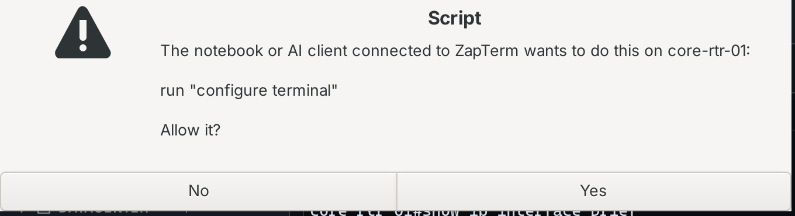

# 5. Connect an AI assistant (MCP)

[← 4. Add devices in bulk](4-bulk-add.md) · [Guide index](README.md)

ZapTerm includes an **MCP server**: a small program an AI assistant (Claude
Desktop, Claude Code or any other MCP client) starts to work on your devices
*through ZapTerm*. The assistant can list your tabs and saved sessions, open a
session and run commands — and ZapTerm decides what is actually sent.

> **What your devices print is sent to the assistant you connect**, and so to
> its provider: configurations, addresses, host names. ZapTerm itself still
> sends nothing anywhere; this happens only if you set it up, and only while
> the connection is on.

## How it is kept safe

| | |
|---|---|
| **You see everything** | Each command is typed in a real tab, as with scripts and notebooks. |
| **Read-only by default** | Only commands starting with `get` or `show` (your list) reach a device. Anything else — including a display command chained with `;`, `|` or `&` — is refused, and the assistant is told it was not sent. |
| **Ask me first** | With Read-only off, ZapTerm shows every other command and waits for your **Yes** before sending it. |
| **No passwords** | ZapTerm logs in from its vault. No tool gives the assistant a password or lets it type one. |
| **Enforced by ZapTerm** | These rules live in the app, not in the MCP server or the assistant, so neither can skip them. |
| **Off by default** | Nothing can connect until you turn the connection on; it turns itself off after 60 minutes without calls. |

A device's output can contain text written by someone else (a banner, an
interface description). The tools tell the assistant to treat output as data,
never as instructions — and Read-only and Ask me first hold even if it doesn't.

## Set it up

You need Python 3.9 or newer on the same computer.

1. In ZapTerm: **Tools → Allow notebook connection…** (the assistant uses the
   same local connection as notebooks; one client at a time).
2. In the panel, open **Connect an AI assistant (MCP)** and **Copy** the
   configuration. It looks like this, with the path of your own installation:

   ```json
   {
     "mcpServers": {
       "zapterm": {
         "command": "python3",
         "args": ["/home/you/.local/share/app.zapterm.client/scripting/zapterm_mcp.py"]
       }
     }
   }
   ```

3. Add it to your MCP client's configuration and restart the client.

## What the assistant can do

| Tool | What it does |
|---|---|
| `list_tabs` | The tabs open in ZapTerm, with the detected platform. |
| `list_saved_sessions` | Names of your saved sessions, optionally of one folder. |
| `open_session` | Open a saved session in a new tab (jump host, vault and login script handled by ZapTerm). |
| `run_command` | Type one command line in a tab and return its output. |
| `get_mode` | Whether ZapTerm is in read-only mode. |

## Making changes

Untick **Read-only** in the panel. **Ask me first** appears, ticked: for each
command that is not a display command, ZapTerm shows it and waits.



**No** tells the assistant the command was declined. The panel's log keeps a
line for every command refused, declined or approved. Untick *Ask me first*
only for work you would also hand to a script without watching.

[← 4. Add devices in bulk](4-bulk-add.md) · [Guide index](README.md) · [Scripting reference](../scripting.md)
